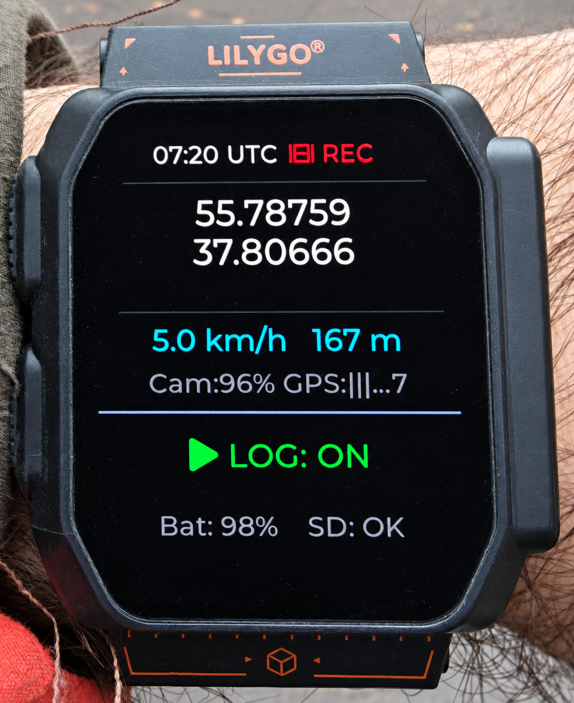

# Как пользоваться GPS-логгером на LILYGO T-Watch Ultra

Часы записывают маршрут и места поклёвок на SD-карту. Камеру для этого можно оставить выключенной.

## Куда нажимать

**На экране** нажимайте на надпись `LOG: ON` или `LOG: OFF` в нижней части дисплея, под горизонтальной линией. **На корпусе** используйте нижнюю из двух кнопок на левой стороне часов. Жесты одинаковые.

| Что сделать | Что нажать | Как понять, что получилось |
| --- | --- | --- |
| Начать маршрут | Удерживайте область `LOG` или боковую кнопку **1,5 секунды**. После вибрации отпустите. | Одна вибрация, на экране зелёное `LOG: ON`. |
| Отметить поклёвку | **Дважды быстро** коснитесь области `LOG` или дважды нажмите боковую кнопку. Пауза между нажатиями — меньше 0,4 секунды. | Три вибрации подряд. Место сохранено как `BITE 1`, `BITE 2` и т. д. Работает и при `LOG: OFF`. |
| Закончить маршрут | Снова удерживайте область `LOG` или боковую кнопку **1,5 секунды**, до вибрации. | Одна вибрация, на экране серое `LOG: OFF`. Записанные точки остаются на SD-карте. |

**Если экран погас**, один раз коснитесь его и отпустите палец. Когда экран загорится, выполните нужный жест. Боковая кнопка работает сразу даже в темноте. Одиночное короткое нажатие этой кнопки управляет видеозаписью камеры. Для поклёвки нажимайте дважды.

## Как проверить запись

- **Перед выходом** посмотрите на строку внизу экрана. `SD: OK` означает, что часы видят карту. При `SD: --` проверьте карту перед стартом.
- **В пути** белые координаты означают, что GPS определил текущее положение. При `GPS connecting...` часы ещё ищут спутники, а оранжевые координаты показывают последнее известное место. Логгер можно включить заранее. Первую точку он запишет, когда получит координаты и время UTC, затем будет добавлять точки примерно раз в минуту. Запись продолжается и при погасшем экране.
- **Если после двойного нажатия была одна длинная вибрация**, метка BITE не сохранилась. Проверьте `SD: OK`, дождитесь белых координат и повторите двойное нажатие, пока находитесь в нужном месте.
- **Если снимаете видео**, при включённом логгере и доступных координатах часы сами добавят метки `REC START` и `REC STOP`, когда камера подтвердит начало и конец записи.

## Где найти маршрут и метки

В корне SD-карты лежат два GPX-файла. Например, для маршрута, начатого 12 ноября 2026 года по UTC, `track_2026_11_12.gpx` содержит трек, а `track_2026_11_12_wpt.gpx` — метки. Чтобы увидеть на карте и линию маршрута, и места поклёвок, откройте оба файла.

Если включить логгер до получения времени UTC, ищите пару с номером сессии, например `track_session_001.gpx` и `track_session_001_wpt.gpx`. При наличии координат метка сохранится даже без времени. Если в этот момент логгер выключен, часы запишут BITE в `track_undated_wpt.gpx`.
